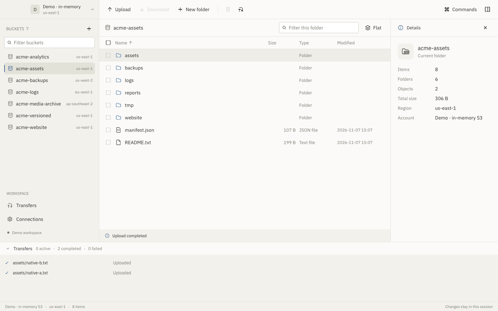

# Storage

Storage is a native macOS desktop app for browsing and managing S3-compatible object storage. It brings buckets, folders, file details, transfers, and sharing links into a three-pane interface built with Zircon UI.

The application and its storage logic are written in Zig. It supports custom S3 endpoints, including Cloudflare R2, and includes an in-memory demo so you can explore the interface without connecting an account.



## What you can do

- Browse buckets and folders, filter objects, sort listings, and select multiple files. Switch to a flat listing to see objects below the current folder.
- Upload multiple files with the native file picker, or drop files onto the current folder or a folder row. See upload progress, transferred bytes, speed, and queued files. Cancel or retry uploads.
- Download individual files, selections, and folders while preserving their relative paths. Existing local files are protected, and completed downloads are published only after their size is checked.
- Create folders, copy or move selections between locations, rename individual files, and recursively delete folders after confirmation.
- Preview text, hexadecimal bytes, and supported images. Image previews support zoom and pan.
- Create expiring signed GET and PUT URLs, choose an expiry, and copy the link to the clipboard.
- Find actions through the searchable command palette, or use keyboard shortcuts.

Storage currently focuses on these core workflows. Multipart and resumable uploads, object versions, bucket settings, sync jobs, encryption controls, and upload rules are outside the current scope. See [current scope and limits](docs/scope.md).

## Development status

This is an early development build for macOS. It depends on the sibling `zigpui` workspace for Zircon UI, text editing, rendering, and the matching Zig toolchain. This repository does not yet provide a standalone dependency download or a signed application release.

S3 request signing and presigned URLs are implemented in Zig. HTTP transport uses libcurl for streaming uploads and the system curl executable for other requests. Credentials and request authorization stay out of process arguments. Accounts can be loaded from the environment or saved in macOS Keychain.

The interface takes inspiration from [Pail](https://github.com/DejavuMoe/Pail). Storage uses its own Zig implementation of the core workflows.

## Build and run

You need macOS, Xcode Command Line Tools, and a compatible local `zigpui` checkout. Arrange the directories like this:

```text
workspace/
├── zigpui/
│   ├── tools/zig
│   └── packages/
│       ├── zircon_ui/
│       ├── zircon_editor/
│       └── zircon_text/
└── storage-ui/
```

The Zircon UI checkout must include native multi-file selection, Finder drops, click modifiers, and masked text inputs. Those APIs are available from zigpui commit `a6a897a` onward.

Clone this repository beside that workspace:

```sh
git clone https://github.com/SyedMuzamilM/storage-ui.git
cd storage-ui
./tools/zig build
open zig-out/Storage.app
```

Use `./tools/zig` for all Zig commands. It selects the Zig 0.17.1 compiler and standard-library overlay from `../zigpui`.

The build produces `zig-out/Storage.app` and `zig-out/bin/storage-ui`. To run the in-memory demo:

```sh
./tools/zig build run -Ddemo=true
```

## Connect your storage

Configure the following environment variables before launching the app:

| Variable | Purpose |
| --- | --- |
| `AWS_ACCESS_KEY_ID` | S3 access key ID |
| `AWS_SECRET_ACCESS_KEY` | S3 secret access key |
| `AWS_SESSION_TOKEN` | Optional temporary-session token |
| `AWS_REGION` | Signing region, such as `us-east-1` or `auto` for R2 |
| `S3_ENDPOINT` | S3-compatible API endpoint |
| `S3_BUCKET` | Bucket to connect to directly |
| `S3_AUTOCONNECT` | Set to `1` to connect on launch |

A bucket-scoped token may not allow account-wide bucket listing. Set `S3_BUCKET` to connect directly. For Cloudflare R2, use your account's S3 endpoint and signing region `auto`.

### Save an account in Keychain

The bundled executable accepts one JSON line on stdin with `--account-stdin`. The fields are `access_key_id`, `secret_access_key`, `endpoint`, `region`, `bucket`, and optional `session_token`.

Add `--remember-account` to save the account in macOS Keychain. Use `zig-out/Storage.app/Contents/MacOS/Storage` for this so Keychain trusts the executable you will launch. Normal launches then load the saved account and connect automatically. A rebuilt development executable may need the account saved again to refresh its Keychain trust.

A complete, nonempty environment credential pair takes precedence over the saved account. Partial environment credentials do not hide it. Keep credentials out of repository files and command arguments.

## Keyboard shortcuts

| Shortcut | Action |
| --- | --- |
| Cmd-K | Open the command palette |
| Cmd-U | Choose files to upload |
| Cmd-D | Download the selection |
| Cmd-R | Refresh the current folder |
| Cmd-A | Select or clear visible objects |
| Cmd-C / Cmd-X / Cmd-V | Copy, cut, or paste objects |
| Enter | Open the selected folder |
| Backspace | Go to the parent folder |
| Escape | Close a dialog or clear the selection |

Use the palette to find preview, rename, signed-link, and other actions. Right-click an object to open its commands.

## Project structure

| Directory | Responsibility |
| --- | --- |
| `src/app` | Browser state, commands, input, and background-job completion |
| `src/models` | Selection, clipboard, preview, and transfer state |
| `src/storage` | S3 requests, XML parsing, SigV4 signing, and storage jobs |
| `src/transfers` | Upload streaming, download validation, and local file publication |
| `src/platform` | Keychain integration and libcurl ABI bindings |
| `src/views` | Separate native views and shared controls |
| `src/testing` | UI driver and opt-in live provider checks |
| `resources` | macOS application metadata |

Format Zig code with `zig fmt`. Use multiline initializers for larger structures and blank lines between logical steps. Keep adjacent fields and related statements together.

## Tests

Run the local checks:

```sh
./tools/zig fmt --check build.zig build.zig.zon src
./tools/zig build test
python3 tools/test_s3.py
./tools/zig build test-native
```

The behavior tests cover storage and UI actions. The local S3 fixture independently verifies SigV4 signatures and checks successful operations, overwrite protection, and error recovery. The native journey exercises AppKit drops, the upload queue, command palette, signed-link dialog, and clipboard copy. It saves demo screenshots under `/tmp/storage-ui-*.png`.

### Live provider checks

With an account configured and an explicit bucket, run:

```sh
zig-out/Storage.app/Contents/MacOS/Storage --test-s3
```

This opt-in test needs read/write permissions. It creates a unique `storage-ui-test-<timestamp>/` prefix and verifies uploads, progress, exact download contents, collision protection, previews, signed GET/PUT links, copy, rename, folder downloads, and recursive deletion. It removes its test objects afterward. If cleanup fails, it prints the test prefix for manual removal. It never changes existing objects outside that prefix.

For read-only checks, `--inspect` lists the configured bucket's root entries, and `--verify-url` performs a one-byte range read through a signed GET URL.
